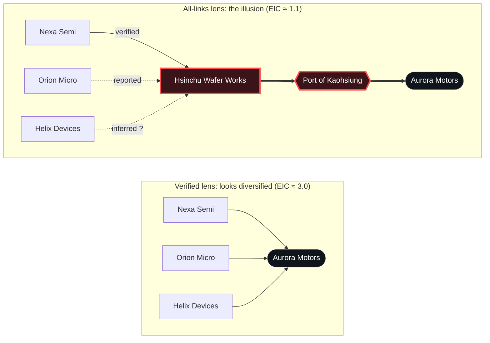
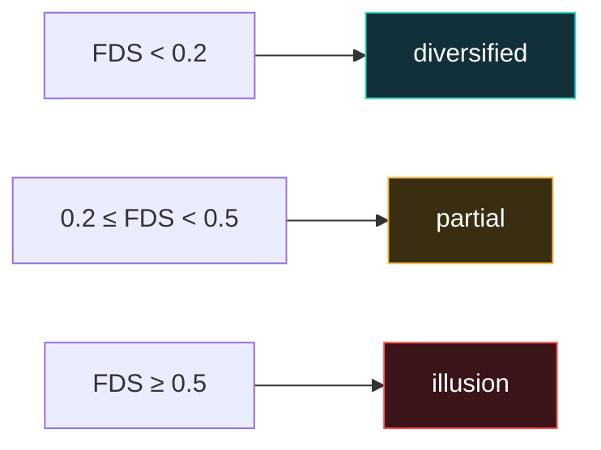
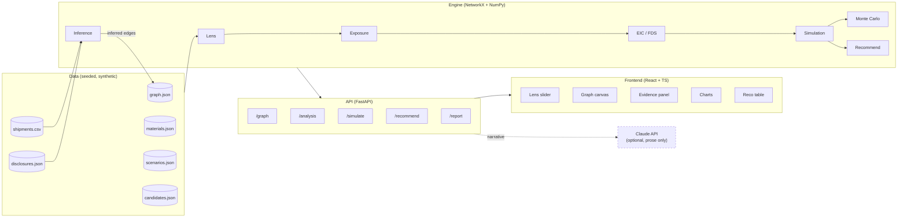
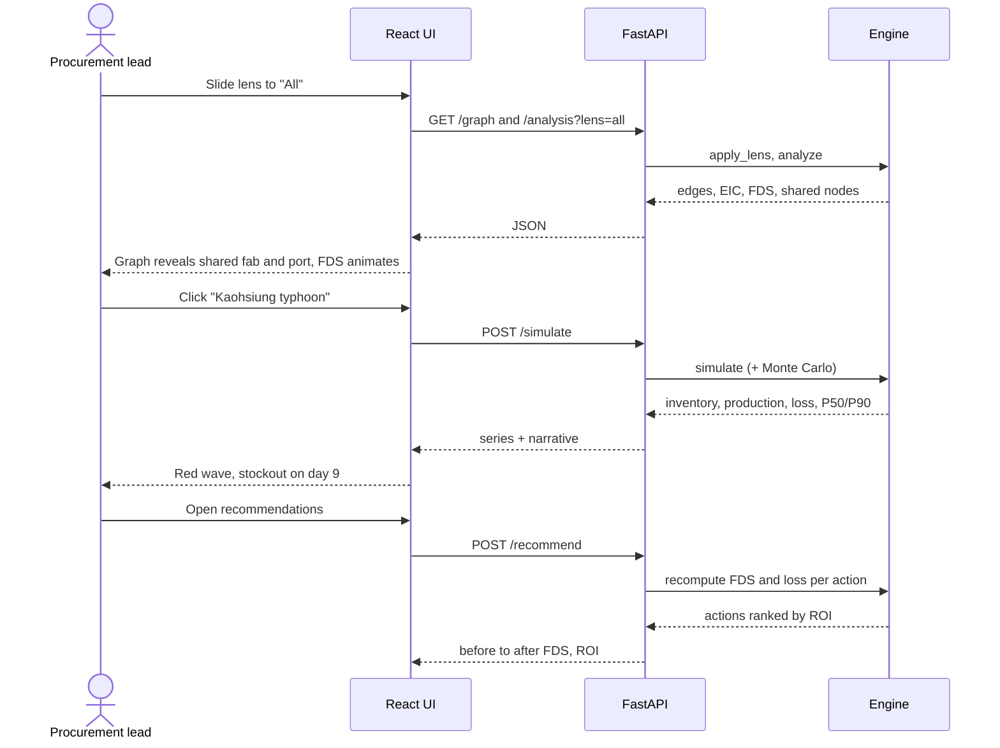
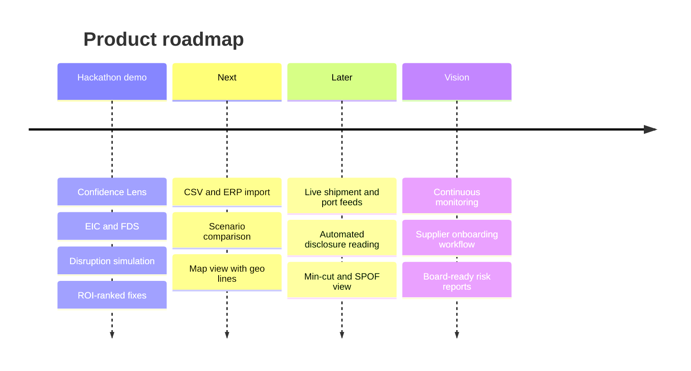

<div align="center">



<br/>


**Team Kelambakkam Atti**

[Live landing page](https://true-tier.vercel.app) · [Plan](plan.md) · [Agent instructions](instructions.md)

</div>

---

## Table of contents

[The problem](#the-problem) · [What TrueTier does](#what-truetier-does) · [The illusion, visualised](#the-illusion-visualised) · [Confidence Lens](#the-demo-moment-confidence-lens) · [Key features](#key-features) · [Metrics](#the-metrics) · [Architecture](#architecture) · [How a request flows](#how-a-request-flows) · [Roadmap](#roadmap) · [Quick start](#quick-start-windows--powershell) · [API](#api) · [Team](#team-kelambakkam-atti)

---

## The problem

Companies judge supply-chain resilience by counting suppliers. But tier-1 suppliers often share hidden upstream dependencies, such as one wafer fab or one port, so "three suppliers" can really be **one point of failure**. The 2021 chip shortage showed automakers losing output to concentration they could not see.

## What TrueTier does

TrueTier builds a **multi-tier supplier network** from procurement records, supplier disclosures and shipment data, exposes hidden common dependencies, and answers three questions:

1. **How independent are my suppliers, really?** (EIC and FDS scores)
2. **What happens to inventory and production if something breaks?** (day-by-day simulation, Monte Carlo P50/P90)
3. **What should I fix first?** (actions ranked by ROI, with the evidence behind each)

Every link is tagged **verified**, **reported** or **inferred**, and the proof is one click away. The distinction is the product.

## The illusion, visualised

What procurement sees when only verified links are trusted, versus what the full evidence shows:



Nominal vs effective supplier count per material (dataset design targets, **All** lens):

```mermaid
xychart-beta
    title "Nominal vs effective independent suppliers"
    x-axis ["Power MCU", "Li-ion cells", "Magnets", "Copper (control)"]
    y-axis "Suppliers" 0 --> 4
    bar [3, 2, 2, 3]
    bar [1.1, 1.3, 1.2, 3]
```



Copper is the **control**: three genuinely separate chains, so the tool correctly says "diversified" and doesn't cry wolf.

## The demo moment: Confidence Lens

| Lens | What the buyer sees | MCU effective independence |
|---|---|---|
| **Verified only** | Three independent chip suppliers | EIC ≈ 3.0 |
| **+ Reported + Inferred** | All three funnel into one wafer fab and one port | EIC ≈ 1.1 |

Then close **Port of Kaohsiung** and watch the red wave propagate: MCU inventory hits zero and production halts around **day 9**.

| Edge class | Line style | Colour |
|---|---|---|
| Verified | solid | teal |
| Reported | dashed | amber |
| Inferred | dotted + "?" | violet |

Styles differ by pattern as well as colour, so the graph stays readable in grayscale and on a projector.

<!-- Add screenshots to docs/img/ and uncomment:


-->

## Key features

- **Confidence Lens**: switch between verified, +reported and all links; graph and hero metric animate.
- **EIC / FDS scoring** per critical material (Effective Independence Count, False Diversification Score).
- **Evidence panel** with contracts, disclosures, shipment records and geo-proximity behind every edge.
- **Disruption simulation**: four presets (typhoon, fab shutdown, rare-earth ban, compound shock) plus custom node disruption.
- **Monte Carlo** that models uncertainty in our own knowledge of the network.
- **ROI-ranked recommendations** (add supplier, buffer stock) with FDS before → after.
- **Printable report** via Jinja2 and browser print-to-PDF.
- **Offline-first**: the optional Claude API writes prose only; deterministic templates take over without internet.

## The metrics

```
EIC(m)         = min(nominal, 1 / max_exposure(m))   # suppliers that are effectively independent
FDS(m)         = 1 - EIC(m) / nominal(m)             # 0 = diversified, → 1 = pure illusion
exposure(u, m) = 1 - availability(m | node u fails)
```



Full formulas are in [plan.md §7](plan.md).

## Architecture



Single process, in-memory, no database, deterministic (`seed=42`).

| Layer | Tech |
|---|---|
| Frontend | React 18, TypeScript, Vite, Tailwind, Cytoscape.js, Recharts, zustand |
| Backend | Python 3.11, FastAPI, Pydantic v2, NetworkX, NumPy, pandas, rapidfuzz |
| Report | Jinja2 + print CSS |
| Optional AI | Anthropic Claude API for narrative text only (never for numbers or rankings) |

## How a request flows



## Roadmap

### 24-hour build plan

```mermaid
gantt
  title METAVERSE 2.0 build timeline (hours from kickoff)
  dateFormat HH:mm
  axisFormat T+%H
  section Foundation
  Scaffold, contracts frozen          :done, f1, 00:00, 1h
  section P0 vertical slice
  Dataset + engine v1 + lens          :p1, 01:00, 7h
  Simulation, charts, evidence panel  :p2, 08:00, 4h
  P0 demo path end-to-end             :milestone, m1, 12:00, 0h
  section P1
  Monte Carlo, recommendations, report:q1, 14:00, 4h
  section Polish and ship
  Visual polish                       :s1, 18:00, 2h
  Feature freeze                      :crit, milestone, m2, 20:00, 0h
  Bug bash, backup video, README      :s2, 20:00, 2h
  Rehearse 3x and submit              :s3, 22:00, 2h
```



### After the hackathon



## Quick start (Windows / PowerShell)

Prerequisites: Python 3.11+, Node 20+, npm.

```powershell
git clone https://github.com/mohamedfadil12/TrueTier.git
cd TrueTier
.\tasks.ps1 setup
.\tasks.ps1 data
.\tasks.ps1 demo
```

Open **http://localhost:5173** (API on `localhost:8000`).

If scripts are blocked: `Set-ExecutionPolicy -Scope CurrentUser RemoteSigned`.

Other commands: `.\tasks.ps1 api` · `.\tasks.ps1 web` · `.\tasks.ps1 test`

Optional LLM narration: copy `.env.example` to `.env` and set `ANTHROPIC_API_KEY`. Leave it empty to run fully offline.

## API

| Method | Path | Purpose |
|---|---|---|
| GET | `/api/graph?lens=` | Nodes, edges (filtered by lens), materials, buyer |
| GET | `/api/analysis?lens=` | EIC, FDS, verdicts, shared nodes and paths |
| GET | `/api/scenarios` | Disruption presets |
| POST | `/api/simulate` | Day-by-day simulation (+ optional Monte Carlo) |
| POST | `/api/recommend` | Ranked actions for a scenario |
| GET | `/api/report` | Print-ready HTML report |
| GET | `/api/health` | Health check |

## Repository structure

```
contracts/   shared TS types and Pydantic models (source of truth)
data/        generated seeded dataset (committed so the demo runs instantly)
scripts/     generate_data.py
backend/     FastAPI app, engine/, golden tests
frontend/    React app
docs/        STATUS.md handoff log, pitch.md, img/
```

## About the data

The demo uses a **fictional, synthetic, seeded** scenario: *Aurora Motors*, an EV maker with a Chennai plant. It is designed to contain real-world patterns (a shared wafer fab, a shared port, a regional dependency) plus a genuinely diversified control. No real company data is used.

## Team: Kelambakkam Atti

| | Member | Role | GitHub |
|---|---|---|---|
|  | **Ammar** | Engine lead: exposure, EIC/FDS, simulation, Monte Carlo | [@mdammar56](https://github.com/mdammar56) |
|  | **Fahadur** | Data & API: dataset generator, FastAPI, report | [@fahadur20git](https://github.com/fahadur20git) |
|  | **Rayyan** | Frontend lead: graph canvas, lens, charts, evidence panel | [@rayyanbasheer](https://github.com/rayyanbasheer) |
|  | **Fadil** | Design, pitch & QA: visual language, deck, demo rehearsal | [@mohamedfadil12](https://github.com/mohamedfadil12) |

## References

Simchi-Levi et al. (2015), *Interfaces* 45(5) · Ivanov & Dolgui (2020), *Int. J. Production Research* 58(10) · Pearl (1988), *Probabilistic Reasoning in Intelligent Systems*

---

<div align="center">Built in 24 hours at METAVERSE 2.0, MSAJCEA Chennai · 29–30 Oct 2026</div>
